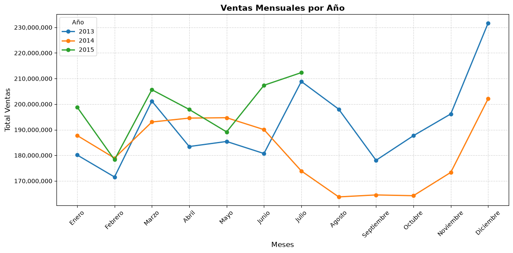
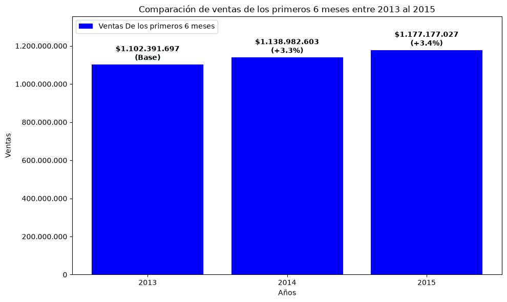
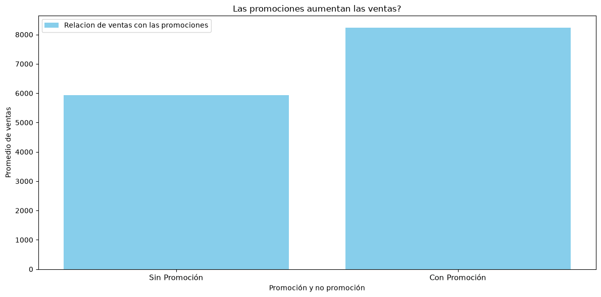
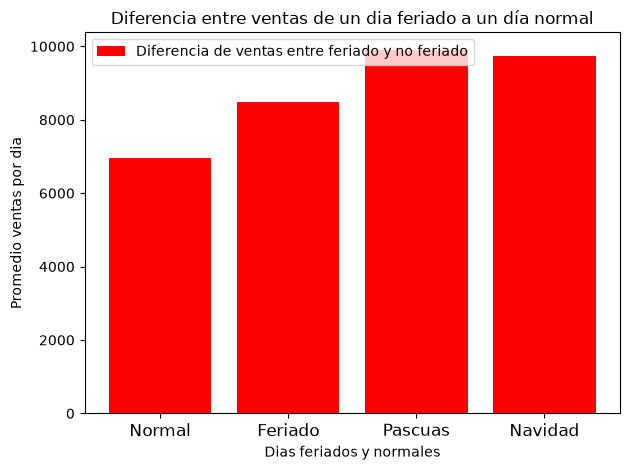
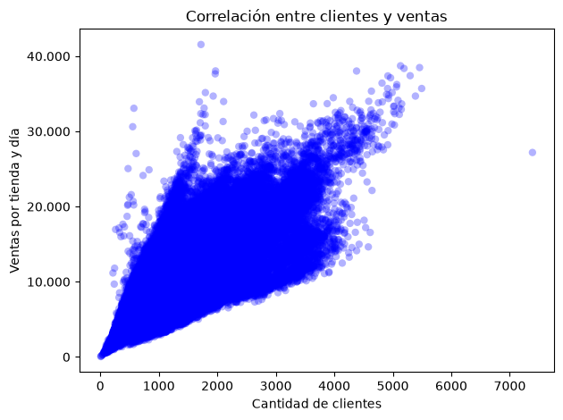

# Análisis de ventas de las droguerías Rossmann

Análisis exploratorio, hecho con Python (pandas y matplotlib), de las ventas diarias de Rossmann, una cadena de droguerías de Alemania. El proyecto responde 6 preguntas sobre cuándo y por qué cambian las ventas.

## Datos

- **Fuente:** Kaggle, competencia *Rossmann Store Sales*, archivo `train.csv`: https://www.kaggle.com/c/rossmann-store-sales/data (Kaggle puede pedir iniciar sesión y aceptar las reglas de la competencia).
- **Contenido:** ventas diarias de 1,115 tiendas, del 1 de enero de 2013 al 31 de julio de 2015 (942 días, 1,017,209 filas).
- **Columnas:** `Store`, `DayOfWeek`, `Date`, `Sales`, `Customers`, `Open`, `Promo`, `StateHoliday`, `SchoolHoliday`.
- El archivo pesa unos 37 MB, por eso **no está en este repositorio**. Se descarga de Kaggle y se coloca junto al script.
- Solo se usó `train.csv`. No se usó `store.csv` (datos de cada tienda).
- El dataset no indica la moneda. Se asume euros, sin confirmar.

## Limpieza de los datos

1. `Date` se convirtió a tipo fecha.
2. `StateHoliday` tenía el valor `0` mezclado como número y como texto. Se unificó como texto: `'0'` día normal, `'a'` feriado público, `'b'` Pascua y `'c'` Navidad.
3. Se eliminaron 172,871 filas: 172,817 días con la tienda cerrada y 54 días con la tienda abierta pero con ventas en cero. Quedan **844,338 filas** (`Open == 1` y `Sales > 0`).
4. No hay valores nulos.

## Total o promedio por tienda y día

En este análisis se usan dos medidas, cada una para una pregunta distinta:

- **Total de ventas:** responde cuánto dinero entró a la empresa.
- **Promedio por tienda y día:** responde qué tan bien vende cada tienda en un día. Es la medida justa cuando cambia el número de tiendas o de días abiertos, que es lo que pasa en este dataset.

## Preguntas y resultados

### 1. Contexto del dataset

Hay **1,115 tiendas**, con datos del 1 de enero de 2013 al 31 de julio de 2015 (942 días). Una tienda vende en promedio unos **6,956** en un día abierto.

### 2. ¿Qué meses venden más y se nota la Navidad?

- Sin contar diciembre, los meses con más ventas totales son **marzo y julio** en 2013 y 2015.
- **Marzo:** se sospecha que se debe a la Pascua, porque la gente se abastece antes de esas fechas. La Pascua cayó a finales de marzo en 2013, a mediados de abril en 2014 y a inicios de abril en 2015, y el pico se mueve con ella. Es una hipótesis, no está comprobada.
- **Julio:** su total es alto porque tiene más días de tienda abierta que otros meses.
- **2014:** de julio a diciembre faltan unas 180 tiendas en los datos, por eso las ventas totales caen. Por tienda, las ventas se mantienen iguales o más altas que en 2013.
- **Diciembre** es el mes más alto en 2013 y 2014. Se nota la Navidad: entran más clientes por tienda y cada cliente gasta cerca de 1 de más (alrededor de 10, frente a 9.2 o 9.5 en otros meses).

### 3. ¿Las ventas crecen o bajan entre 2013, 2014 y 2015?

Las ventas crecen cerca de un **3 % cada año**. Para comparar con justicia se usan solo los primeros 6 meses de cada año, porque 2015 llega hasta julio y en julio de 2014 ya faltaban unas 180 tiendas (posible remodelación, sin confirmar).

| Primeros 6 meses | Ventas totales | Cambio |
|---|---|---|
| 2013 | 1,102,391,697 | (base) |
| 2014 | 1,138,982,603 | +3.3 % |
| 2015 | 1,177,177,027 | +3.4 % |

### 4. ¿Las promociones aumentan las ventas y cuánto en promedio?

Sí. Una tienda vende en promedio **5,930** en un día sin promoción y **8,229** en un día con promoción: alrededor de un **39 % más** por tienda y por día. Se compara el promedio y no el total porque hay más días sin promoción que con promoción.

### 5. ¿Los feriados cambian las ventas frente a un día normal?

Sí. Por tienda y día, los feriados venden más que un día normal:

| Tipo de día | Promedio por tienda y día |
|---|---|
| Normal | 6,954 |
| Feriado público (`a`) | 8,487 |
| Pascua (`b`) | 9,888 |
| Navidad (`c`) | 9,744 |

Hay que leerlo con cuidado: los feriados salen de muy pocas filas (694, 145 y 71, frente a 843,428 días normales), porque pocas tiendas abren esos días. Las tiendas que abren podrían no ser representativas del resto.

### 6. ¿Qué tan relacionados están los clientes y las ventas?

La correlación entre `Customers` y `Sales` es de **0.82**: a más clientes por tienda en un día, más se vende. Es una relación fuerte, pero no perfecta: las ventas también dependen de cuánto gasta cada cliente, de las promociones y de otros factores. Que dos variables se muevan juntas no demuestra que una cause la otra.

## Limitaciones

- **Tiendas que faltan en 2014:** de julio a diciembre de 2014 hay unas 935 tiendas en lugar de 1,115, y no aparecen como cerradas: directamente no tienen filas. No se sabe la causa. Una teoría es la remodelación, pero Rossmann no lo confirma en los datos.
- **Feriados:** pocas filas y posiblemente tiendas distintas a las de un día normal.
- **Hipótesis sin comprobar:** el efecto de la Pascua sobre marzo y abril, y que la gente se abastece antes de esas fechas.
- **Moneda:** el dataset no la indica.
- **Alcance:** solo se usó `train.csv`, y los datos terminan en julio de 2015.

## Cómo ejecutarlo

1. Instala Python 3 y las librerías: `pip install numpy pandas matplotlib`
2. Descarga `train.csv` de Kaggle y guárdalo en tu computador.
3. En `rossman_analisis.py`, cambia la ruta `file_path` por la ubicación de tu `train.csv`.
4. Ejecuta: `python rossman_analisis.py`

## Herramientas

Python, pandas, NumPy y Matplotlib.
